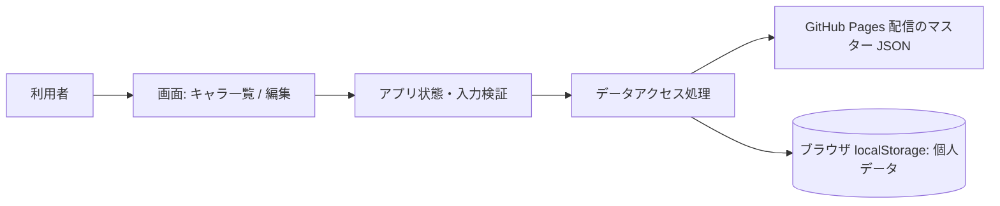
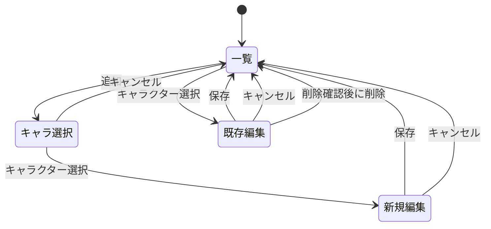

# ブルーアーカイブ育成状況管理 Web アプリ 基本設計

## 1. 文書情報

- 文書の状態: プロトタイプ実装反映済み
- 対応する要件: [requirements.md](requirements.md)
- 設計の前提: 初版は現在の育成状況のみを扱い、ゲーム定義はリポジトリ管理のマスターデータから読み込む

## 2. 設計方針

- GitHub Pages で配信できる静的なクライアントサイド Web アプリとする。
- キャラクター名、スキル名、応用WBの属性、装備種別などをリポジトリ内の静的マスターデータとして管理する。
- 利用者の育成記録はマスターと分離し、キャラクター ID を参照する形でブラウザ内に保存する。
- マスターのデータ形式は JSON を採用する案とする。キャラクターごとに異なる属性・スキル構成を関連付けやすく、ブラウザで追加ライブラリなしに読み込めるため。CSV 出力は別機能として後続対応する。
- キャラクターごとに育成状況をまとめて保存し、一覧表示・編集・削除を行う。
- データ保存はブラウザの `localStorage` を使用する。サーバー通信、ログイン、同期は行わない。
- 保存データにスキーマバージョンを付け、育成項目の追加や将来の CSV 出力に対応しやすくする。
- ゲーム内項目の段階数・上限値・選択肢は、公開情報を調査して入力仕様へ反映する。確認できないプロジェクト固有の判断のみ利用者へ質問する。
- 応用WBはキャラクターごとに3属性を定義し、各属性のレベルを0〜25とする。Lv0は初期値であり、未開放状態ではない。☆5以上で育成可能。
- プロトタイプのマスターは一部キャラクターで開始し、公開前に現時点の全キャラクターと衣装違いを収録する。

## 3. システム構成



### 3.1 構成要素

| 要素 | 責務 |
| --- | --- |
| 画面 | キャラクター一覧と編集フォームを表示し、操作を受け付ける |
| アプリ状態・入力検証 | 選択中画面、編集中データ、入力エラーを管理する |
| データアクセス処理 | マスター JSON と利用者データの読み込み、利用者データの追加・更新・削除、形式検証を行う |
| マスター JSON | キャラクター、スキル、応用WB属性、装備種別などのゲーム定義を提供する |
| localStorage | 同じブラウザ・オリジン内に利用者個人の所持・育成データを保持する |

初版ではクライアント内で完結させる。マスター JSON は読み取り専用で、変更はリポジトリのコミットと GitHub Pages の再デプロイによって反映する。画面とデータアクセス処理を分け、将来 CSV 入出力や保存方式を追加する際に画面側への影響を抑える。

## 4. 画面設計

初版は URL ルーティングを必須とせず、単一ページ内の画面切り替えで構成する。GitHub Pages のサブパス公開で、画面 URL の直接アクセスや再読み込みが失敗する問題を避ける。

### 4.1 キャラクター一覧

- 登録済みキャラクターを一覧表示する。表示名はマスターデータから取得する。
- 各行にキャラクター名と、一覧で判別するための主要育成状況を表示する。
- 「キャラクター追加」操作でマスターからキャラクターを選ぶ画面を開く。
- 利用者全体の設定として先生レベルを変更できる。
- 一覧のキャラクターを選択すると編集フォームを開く。
- 編集成功後は一覧へ戻り、更新された内容を表示する。
- 登録がない場合は空状態と追加操作を表示する。

### 4.2 キャラクター編集フォーム

- 新規追加と既存データの編集で同じフォームを使用する。
- マスターで定義されたキャラクター名と育成項目を表示する。名前は利用者が編集しない。
- 応用WBは選択したキャラクターに定義された3属性を表示し、それぞれLv0〜25の現在値を入力する。能力解放の利用可能条件（キャラクターLv90かつ★5）を満たさない場合も値は保持し、条件を補足表示する。
- 装備枠はキャラクターLvに応じて解放状態を表示する。未解放枠の入力は無効にし、解放Lvに達すると入力可能にする。
- 保存前に入力値を検証する。数値範囲の最小値など、マスターで表現できない制約は項目仕様に従う。
- 保存操作で確定し、キャンセル操作では編集中の変更を保存しない。
- 既存キャラクターの編集時のみ削除操作を表示し、削除前に確認する。
- 育成項目の入力形式と値域は「8. 継続作業」に記載した公開情報調査とマスター仕様に従う。

### 4.3 初版の画面遷移



### 4.4 画面項目配置案

#### 一覧

| 領域 | 表示・操作 |
| --- | --- |
| ヘッダー | アプリ名、先生レベル設定、登録済み人数 |
| 操作列 | キャラクター名検索、「キャラクター追加」 |
| キャラクター行 | 名前・衣装、★、Lv、絆、スキル概要、WB概要 |
| 行操作 | キャラクター詳細・編集を開く |
| 空状態 | 登録がない旨と追加操作 |

#### キャラクター選択

- 名前検索を備え、未所持キャラクターのみ表示する。
- 衣装違いは別キャラクターとして表示し、必要なら同一生徒のまとまりも判別できるようにする。
- マスター未登録キャラクターの自由入力欄は設けない。

#### キャラクター編集

| セクション | 入力項目 |
| --- | --- |
| 基本 | マスター名（表示のみ）、★、キャラクターLv、絆ランク |
| スキル | マスター定義された各スキルの現在Lv |
| 能力解放 | キャラ固有のWB属性3つを個別に0〜25で入力 |
| 装備 | マスター定義の3枠。未解放枠はロック表示、解放後はTierとTier内Lv |
| 固有武器 | ★段階とLv。未解放の場合は条件を表示 |
| 愛用品 | マスターに対象定義がある場合のみT1/T2を表示 |
| フォーム操作 | 保存、キャンセル。既存データでは削除も表示 |

保存前に、★・絆・先生Lv・スキル・WB・装備・固有武器・愛用品の関連上限を検証する。上限値はゲーム設定またはマスター定義を参照する。

## 5. データ設計

### 5.1 保存単位

ゲーム定義のマスターと利用者個人の記録は別データとして管理する。以下は論理構造の例であり、マスターはリポジトリの JSON ファイル、個人データは `localStorage` に保存する。

```json
{
  "schemaVersion": 1,
  "characters": [
    {
      "id": "character-id",
      "name": "キャラクター名",
      "initialStarGrade": 3,
      "variantGroupId": "base-character-id",
      "skills": [
        { "id": "ex-skill-id", "type": "ex", "name": "EXスキル名", "maxLevel": 5 },
        { "id": "normal-skill-id", "type": "normal", "name": "ノーマルスキル名", "maxLevel": 10 },
        { "id": "passive-skill-id", "type": "passive", "name": "パッシブスキル名", "maxLevel": 10 },
        { "id": "sub-skill-id", "type": "sub", "name": "サブスキル名", "maxLevel": 10 }
      ],
      "wbAttributes": [
        { "id": "attribute-a", "name": "能力名", "maxLevel": 25 },
        { "id": "attribute-b", "name": "能力名", "maxLevel": 25 },
        { "id": "attribute-c", "name": "能力名", "maxLevel": 25 }
      ],
      "equipmentSlots": [
        { "id": "slot-1", "equipmentTypeId": "equipment-type-id", "unlockedAtLevel": 1 },
        { "id": "slot-2", "equipmentTypeId": "equipment-type-id", "unlockedAtLevel": 10 },
        { "id": "slot-3", "equipmentTypeId": "equipment-type-id", "unlockedAtLevel": 20 }
      ],
      "hasUniqueWeapon": true,
      "favoriteItem": { "id": "favorite-item-id", "name": "愛用品名", "maxTier": 2 }
    }
  ],
  "equipmentTypes": [
    { "id": "hat", "name": "帽子" },
    { "id": "gloves", "name": "グローブ" },
    { "id": "shoes", "name": "シューズ" },
    { "id": "bag", "name": "バッグ" },
    { "id": "badge", "name": "バッジ" },
    { "id": "hairpin", "name": "ヘアピン" },
    { "id": "amulet", "name": "お守り" },
    { "id": "watch", "name": "腕時計" },
    { "id": "necklace", "name": "ネックレス" }
  ],
  "settings": { "maxSenseiLevel": 90 }
}
```

各キャラクターの `wbAttributes` は必ず3件とし、各属性の `maxLevel` は25とする。実際の属性名・内訳はキャラクターごとに異なる。

利用者データの例:

```json
{
  "schemaVersion": 1,
  "account": { "senseiLevel": 90 },
  "characters": [
    {
      "id": "owned-record-id",
      "characterId": "character-id",
      "growth": {
        "starGrade": null,
        "level": null,
        "skills": { "skill-id": null },
        "wbLevels": { "attribute-a": null, "attribute-b": null, "attribute-c": null },
        "bond": null,
        "equipment": {
          "slot-1": { "tier": null, "level": null },
          "slot-2": { "tier": null, "level": null },
          "slot-3": { "tier": null, "level": null }
        },
        "uniqueWeapon": { "starGrade": null, "level": null },
        "favoriteItem": { "tier": null }
      },
      "createdAt": "ISO-8601日時",
      "updatedAt": "ISO-8601日時"
    }
  ]
}
```

育成値の `null` は未入力、数値の `0` は確認済みの初期値を表す。WBに「未開放」状態は設けない。スキルの種類や上限はキャラクター定義ごとに保持し、同名の衣装違いは別のキャラクターIDとして扱う。`variantGroupId` は衣装違いをまとめて表示・検索する場合に使用する。

### 5.2 育成データ辞書（初版案）

| 項目 | 利用者データ | マスター定義 | 方針・値域 |
| --- | --- | --- | --- |
| レアリティ | `growth.starGrade` | 初期レアリティ | 現在の★を記録する。全キャラクター★1〜5 |
| 先生レベル | `account.senseiLevel` | 現行の最大先生レベル | 利用者全体に1値を設定し、キャラクターレベルの入力上限として使う |
| レベル | `growth.level` | アプリ共通の最大値 | 現在レベルを記録する。入力上限は `min(先生レベル, 現行最大値)` |
| スキル | `growth.skills[skillId]` | ID、名前、種別、最大レベル | EX、ノーマル、パッシブ、サブを個別管理。アルのSchaleDBページではEX Lv1〜5、他3種Lv1〜10を確認。数値はマスターで個別定義する |
| 応用WB | `growth.wbLevels[attributeId]` | キャラ別3属性のID、名前、上限25 | 現在値0〜25。0は初期値、未入力は `null` |
| 絆 | `growth.bond` | レアリティ別上限 | 現在ランクを整数1以上で記録。上限は★1〜2:10、★3:20、★4:30、★5:100 |
| 装備 | `growth.equipment[slotId]` | キャラ別スロット、装備種別、解放Lv、現行Tier/Lv範囲 | 各枠の現在TierとTier内レベルを記録する。現行スロット解放はLv1/10/20。TierとLv範囲はマスター設定で更新可能にする |
| 固有武器 | `growth.uniqueWeapon` | ★5で解放、現行の最大段階・レベル | ★段階とレベルを分けて記録する |
| 愛用品 | `growth.favoriteItem` | 対象キャラ、愛用品名、最大Tier 2 | 対象キャラのみT1/T2を記録。未所持・未入力は `null`、対象外キャラには項目を出さない |

この表は基本設計の初版モデルである。レベル上限やスキルの最大値など、ゲーム更新やキャラクター定義に依存する値は固定値を画面コードへ埋め込まず、マスターまたはゲーム設定定義で管理する。スキル上限は参照例を他の全キャラクターへ無条件に適用せず、マスター作成時に確認する。

### 5.3 項目の意味

| 項目 | 用途 |
| --- | --- |
| `schemaVersion` | マスターまたは利用者データ形式のバージョン |
| `account.senseiLevel` | 利用者全体の先生レベル。キャラLvの上限判定に利用 |
| マスター `characters[].id` | ゲーム内キャラクター定義の安定 ID |
| 利用者 `characters[].id` | 所持記録を識別する内部 ID |
| 利用者 `characters[].characterId` | マスターのキャラクター定義を参照する ID |
| `variantGroupId` | 衣装違いなど同一生徒のバリエーションをまとめる任意の ID |
| `skills` | キャラクター固有スキルの安定ID、表示名、種別、上限を定義する |
| `wbAttributes` | キャラクター固有の3属性と各最大レベルを定義する |
| `equipmentSlots` | キャラクターの装備枠、装備種別、解放レベルを定義する |
| `favoriteItem` | 愛用品の対象者、名称、最大Tierを定義する。対象外は省略する |
| `growth` | キャラクターの現在の育成状況 |
| `createdAt` / `updatedAt` | 利用者レコードの作成日時・最終更新日時 |

### 5.4 保存キー

- マスターはリポジトリ内の JSON として管理する。プロトタイプのファイルは `data/master/characters.json`、`data/master/equipment-types.json`、`data/master/settings.json` とし、スキル・WB・装備枠・愛用品はキャラクター定義内に置く。
- `schemas/character-master.schema.json` でキャラクターマスターの形を定義する。アプリ実装時は同じ制約を実行時またはテスト時に検証する。
- `scripts/validate-master.ps1` はマスター間のID参照、WB3属性、装備枠3つ、装備種別、スキルID重複、共通設定を依存ライブラリなしで検査する。
- 実装時はビルド設定に合わせ、マスター JSON が GitHub Pages から静的配信される配置にする。
- `localStorage` の個人データ用キーにはアプリ固有の名前空間を付ける。
- GitHub Pages のプロジェクトサイトは同じ `github.io` オリジン配下で共有される場合があるため、パスだけに依存せず、他アプリと衝突しにくい固定キーを使う。
- 実際のキー文字列は実装開始時にアプリ名と合わせて確定する。

### 5.5 マスターの保守

- リポジトリ内のマスター JSON をこのアプリの正とする。実行時に外部 API を必須とせず、GitHub Pages の静的配信だけで動作させる。
- マスター全体にデータ版、対象地域、最終確認日を付ける。キャラクターの追加・更新時は、確認した資料またはゲーム内表示と確認日を記録する。
- キャラクターの初回登録時は、マスターの `initialStarGrade` を利用者データの初期値にする。以降の星上げは利用者データで管理する。
- 初期プロトタイプでは少数のキャラクターだけを登録し、データ構造と画面を先に検証する。全衣装違いの網羅は公開前のデータ作成・検証タスクとする。
- SchaleDBのWebサイトは項目構造や数値の照合先として使えるが、公開GitHubリポジトリは2025-06-03にアーカイブされている。更新中の一次データ源として扱わず、Webサイトの可用性にも実行時依存しない。
- マスターにゲーム画像を含めることは本設計では前提としない。まずテキストの識別情報・定義データを扱い、画像の利用が必要になった場合は権利・出典・配信方法を別途確認する。

## 6. 保存・読み込み処理

### 6.1 起動時

1. リポジトリから配信されたマスター JSON を読み込む。
2. マスターの形式、IDの一意性、キャラクターごとのWB属性が3件であること、各最大レベルが25であることを検証する。
3. 固定キーから利用者データを読み込む。データがなければ空の所持一覧で開始する。
4. 利用者データの形式とマスター ID 参照を検証してから画面状態へ読み込む。
5. マスターまたは利用者データが不正・未対応の場合、個人データを黙って上書きせず、読み込みエラーを表示する。

### 6.2 更新時

1. フォーム入力を検証する。
2. アプリ内のキャラクターデータを追加・更新・削除する。
3. バージョン付きデータ全体を `localStorage` へ保存する。
4. 保存に成功した場合のみ操作完了として一覧へ戻る。

### 6.3 エラー時

- `localStorage` が利用できない、または容量不足で保存に失敗した場合、失敗を利用者に通知する。
- 保存失敗時は入力内容を画面から消さず、再試行できる状態にする。
- データ消去や破損の可能性、端末間で同期されないことをアプリ内で案内する。

## 7. 将来の CSV 出力への備え

- キャラクター単位のレコードを保ち、画面表示用の文字列だけを保存値にしない。
- 育成項目は意味の分かるキーと型付きの値として管理する。
- CSV 出力時は保存モデルから列を組み立てる専用処理を設け、画面表示と出力形式を分離する。
- CSV の列構成、文字コード、空欄表現は CSV 機能の設計時に決定する。

## 8. 継続作業

### 8.1 ゲーム仕様の調査・マスター整備

以下はゲーム仕様として公開情報を調査し、マスターまたは設定データへ反映する作業であり、ユーザー回答待ちにはしない。

| 項目 | 調査・整備内容 |
| --- | --- |
| レベル | Senseiレベル等を含む現行上限と入力制約を確認する |
| スキル | 各スキル種別の上限とキャラクター別例外を確認する |
| 絆 | 現行の表示単位と上限を確認する |
| 装備 | 各枠の装備種別、現行TierとTier内レベル範囲、未装備表現を確認する |
| 固有武器 | ★段階・レベルの範囲と未入手表現を確認する |
| 愛用品 | 対象キャラクター、Tier範囲、未所持表現を確認する |
| 応用WB | キャラクター別の3属性をマスター化し、Lv0と未入力のUI表現を実装で区別する |
| キャラクター一覧 | 公開前に現行の全キャラクターと衣装違いを収録し、重複・欠落を検証する |

### 8.2 プロトタイプの設計既定値

- 所持データはマスターのキャラクターIDごとに1件とする。同じ生徒の衣装違いは別IDとして個別に管理する。
- キャラクター一覧は名前検索を用意し、日本語名順を初期並び順とする。
- 先生レベルはアカウント設定として記録し、キャラクターレベルの最大入力値に反映する。
- 応用WBの `0` は画面でも数値0として扱い、`null` の未入力と区別する。
- 初版ではCSV等のバックアップ出力は実装せず、ブラウザ内保存の制約を案内する。CSV出力は後続機能で対応する。
- 初回公開の対象地域は日本版を暫定基準とし、マスターには対象地域と確認日を持たせて将来の地域差に対応できるようにする。

## 9. 次工程

1. ゲーム仕様を追加調査し、プロトタイプ用マスターのデータ形式と検証ルールを確定する。
2. データスキーマとフォーム項目を確定する。
3. 一覧・編集画面のワイヤーフレームを作成する。
4. 技術スタックと実装タスクを決定する。

## 10. 仕様調査の参照先

- [SchaleDB 生徒一覧](https://schaledb.com/student): プレイアブル生徒の一覧と衣装違いの識別を確認。非公式データベースであることを前提に、網羅性・表示項目の照合先として使う。
- [SchaleDB アルのページ](https://schaledb.com/student/aru): スキル種別、装備枠、固有武器、愛用品、応用WBの表示例を確認。
- [SchaleDB ホーム](https://schaledb.com/home): 同サイトが非公式であり、生徒のステータス・スキル・固有武器・装備を掲載すると説明していることを確認。
- [SchaleDB GitHub リポジトリ](https://github.com/SchaleDB/SchaleDB): データファイルの構造確認用。2025-06-03にアーカイブ済みであり、現行データ源として依存しない。
- [神ゲー攻略: キャラ育成要素](https://kamigame.jp/bluearchive/page/143077002490962129.html): キャラLvが先生Lvで制限されること、★5で固有武器が解放されること等を確認。
- [神ゲー攻略: 絆ランク](https://kamigame.jp/bluearchive/page/143074853681932278.html): レアリティ別の絆上限（★1〜2:10、★3:20、★4:30、★5:100）、愛用品の解放に絆15・T2に絆20が必要なことを確認。最終更新 2026-09-23。
- [神ゲー攻略: 装備](https://kamigame.jp/bluearchive/page/142382176657267643.html): 装備カテゴリ、Tierとレベルの強化構造を確認。最終更新 2026-04-21。同記事内のLv15/35は旧仕様と判断し、現行解放Lvは新しい先生レベル記事に従う。
- [神ゲー攻略: キャラクター育成要素](https://kamigame.jp/bluearchive/page/143077002490962129.html): 全キャラクター★5到達、★5で固有武器解放を確認。最終更新 2026-06-01。
- [神ゲー攻略: 先生レベル](https://kamigame.jp/bluearchive/page/142932339821927927.html): 先生Lv上限90、キャラLv上限が先生Lvに連動すること、装備枠解放が旧Lv15/35からLv10/20へ緩和されたことを確認。最終更新 2026-02-17。上限は将来変わる可能性があるためマスター設定で保持する。

確認日: 2026-10-02。アルのスキル画面のレベル選択範囲はEXがLv1〜5、その他の3スキルがLv1〜10。アルのWB表示例はHP・攻撃・治癒力。能力解放はキャラクターLv90かつ★5で利用可能と資料に記載されている。これらは個別ページ・攻略資料の確認内容であり、他キャラクターの構成・例外を含む全件はマスター作成時に照合する。ゲーム内数値・名称は更新されるため、最終的なマスター編集時に地域と更新時点を記録し、ゲーム内表示または現行資料で再確認する。SchaleDBは調査・照合用であり、サービス依存や画像アセットの複製を意味しない。

## 11. 技術構成

- UI: React + TypeScript + Vite。少数の画面と複数の入力グループをコンポーネント単位に分け、静的ファイルとしてビルドする。
- ゲームマスター: リポジトリ内のJSONファイルを正本とし、アプリのビルド時に取り込む。外部APIへの実行時依存は作らない。
- 個人データ: バージョン付きJSONを `localStorage` に保存する。保存アクセスを専用モジュールへ分離する。
- 公開: GitHub Pages。Viteの `base` をプロジェクトサイトのリポジトリ名に合わせる。
- テスト: `scripts/validate-master.ps1` でマスター参照と値域を検査し、`npm run build` で型検査・本番ビルドを行う。主要画面操作はブラウザーで確認する。

実装開始時にリポジトリ名とデプロイ先URLを確認して `base` とデプロイ設定を確定する。依存ライブラリは最小限とし、ゲームデータ・個人データの処理と表示を分離する。

## 12. プロトタイプ進捗

- JSONマスターの試作: アル1衣装分を登録。スキル4種、WB3属性、装備3枠、固有武器有無、愛用品を含む。
- 共通マスター: 装備9種と先生Lv・絆上限・装備枠解放・能力解放条件を登録。
- データ形式: JSON Schemaとマスター検証スクリプトを追加。ゲーム更新で変わる装備Tierや固有武器Lvの上限は、根拠確認後にマスターへ追加する。
- 画面: [wireframes.md](wireframes.md) を基に、一覧・キャラクター選択・編集のReact画面を実装済み。
- 保存: バージョン付きlocalStorage、読み込み不能時の保護、保存失敗通知を実装済み。
- 公開: GitHub ActionsによるPagesデプロイ定義を追加済み。
- 検証済み: マスターJSONの構文と参照整合性、WB3属性、装備枠3つ、装備種別IDを検査済み。ソース診断も問題なし。
- 検証済み: Node.js 24.19.0環境で本番ビルド成功。ブラウザーで一覧・追加・編集・保存・再読み込み・削除を確認し、デスクトップとモバイルの表示を確認。
- 検証済み: GitHub Actions相当の `GITHUB_REPOSITORY=KuroyukiKobo/checker` を設定したビルドで、生成アセットの `/checker/` サブパスを確認。
- 検証済み: 絆条件未達の愛用品T2保存と、登録キャラLvを下回る先生Lv設定を拒否することを確認。
- 残作業: マスターはプロトタイプのアル1衣装のみ。全衣装の登録、ゲーム更新ごとの値域照合、リポジトリ本番URLでのGitHub Pagesデプロイ確認。
- 次の作業: 全生徒マスターの収録を進める。Tier・固有武器の現行上限が確認できた項目はマスター設定へ追加し、確認できない項目は記録方法を保留値として維持する。